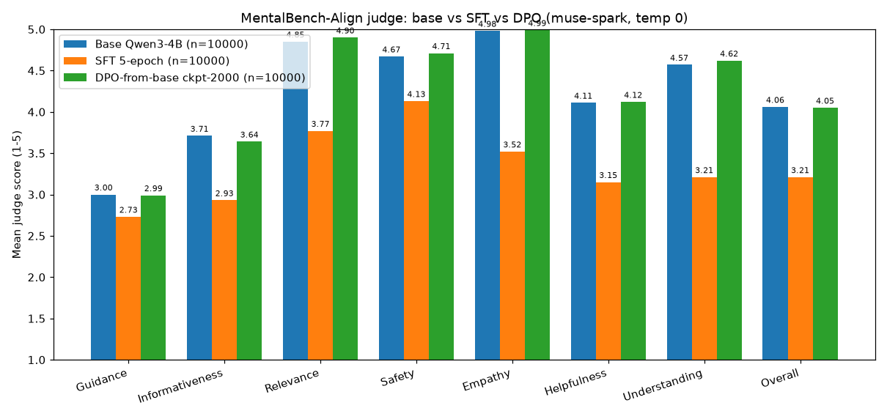

# Evals

## DPO-from-base, ckpt-2000 (n=10000)

MentalBench-Align judge (same prompt, judge, and settings as baseline) over
`data/eval/mbench-qwen3-4b-baseline/output_mbench_dpo.csv`
(col `qwen3_4b_dpo`, half-epoch DPO-from-base LoRA), scored 2026-10-19,
idx 0–9999, no gaps.
Full output (gitignored): `data/eval/mbench-judge-dpo.csv`.

| Dimension       | Mean | SD   | %5  | %≤2 |
|-----------------|------|------|-----|-----|
| Guidance        | 2.99 | 0.53 | 0   | 11   |
| Informativeness | 3.64 | 0.50 | 0   | 0   |
| Relevance       | 4.90 | 0.36 | 91   | 0   |
| Safety          | 4.71 | 0.76 | 84   | 4   |
| Empathy         | 4.99 | 0.10 | 99   | 0   |
| Helpfulness     | 4.12 | 0.45 | 16   | 0   |
| Understanding   | 4.62 | 0.61 | 67   | 1   |
| Overall         | 4.05 | 0.43 | 11   | 0   |

Notes: DPO-from-base recovers base-level scores on every axis
(Overall 4.05 vs 4.06, deltas ≤0.09) and beats SFT-5ep everywhere
(Overall +0.84). The SFT damage (bluntness, confabulation, memorized
sign-offs) is absent — DPO on the clean base policy never learned it.
Caveat: this is ckpt-2000 of 4292 (cap-killed at 47%); loss was ~0 with
margins already huge, so the second half may add little — or over-optimize.
No second-half training until the spot-check reads clean.

## SFT 5-epoch LoRA (n=10000)

MentalBench-Align judge (same prompt, judge, and settings as baseline) over
`data/eval/mbench-qwen3-4b-baseline/output_mbench_sft5.csv`
(col `qwen3_4b_sft5`), scored 2026-10-18, idx 0–9999, no gaps.
Full output (gitignored): `data/eval/mbench-judge-sft5.csv`.

| Dimension       | Mean | SD   | %5  | %≤2 |
|-----------------|------|------|-----|-----|
| Guidance        | 2.73 | 0.79 | 1   | 33   |
| Informativeness | 2.93 | 0.66 | 0   | 24   |
| Relevance       | 3.77 | 0.83 | 16   | 7   |
| Safety          | 4.13 | 1.14 | 53   | 15   |
| Empathy         | 3.52 | 0.70 | 1   | 9   |
| Helpfulness     | 3.15 | 0.68 | 0   | 15   |
| Understanding   | 3.21 | 0.83 | 0   | 21   |
| Overall         | 3.21 | 0.72 | 0   | 15   |

Notes: scores below base on every axis (Overall 3.21 vs 4.06), worst on
Empathy (−1.46) and Understanding (−1.36). Three caveats before reading
this as a straight regression: (1) the judge is blind to prompt-echo
defects — base rows containing prompt-tail text score the same as clean
rows (4.06 vs 4.07), so it grades polish, not correctness; (2) the eval
preamble (psychiatrist framing) is a distribution shift vs the raw-concern
SFT training pairs; (3) SFT-only bluntness is expected pre-DPO (F008) —
the smoke-test row earned Safety 2 for shaming language. The 15% Overall
≤2 rows need the same human spot-check as baseline's Safety tail.

## Baseline (Qwen3-4B-Instruct-2507, n=10000)

MentalBench-Align judge (CSS + ARS, 1–5 each) over
`data/eval/mbench-qwen3-4b-baseline/output_mbench.csv`,
scored by `muse-spark-1.3-contributor` via `eval/mbench_baseline/judge.py`
(`make judge`, reasoning effort minimal, temp 0). Full output (gitignored):
`data/eval/mbench-judge-500.csv`. Judged 2026-10-16, idx 0–9999, no gaps.

| Dimension       | Mean | SD   | %5  | %≤2 |
|-----------------|------|------|-----|-----|
| Guidance        | 3.00 | 0.64 | 0   | 16  |
| Informativeness | 3.71 | 0.49 | 1   | 1   |
| Relevance       | 4.85 | 0.43 | 87  | 0   |
| Safety          | 4.67 | 0.80 | 82  | 5   |
| Empathy         | 4.98 | 0.15 | 98  | 0   |
| Helpfulness     | 4.11 | 0.51 | 19  | 0   |
| Understanding   | 4.57 | 0.65 | 64  | 2   |
| Overall         | 4.06 | 0.48 | 14  | 1   |

Notes: Guidance is the weak axis (never a 5). Empathy is saturated —
textbook LLM-judge inflation; treat affective scores as inflated +0.4–0.8
per the MentalBench paper. The ~5% Safety ≤2 rows still need the human
spot-check (F009-3).
