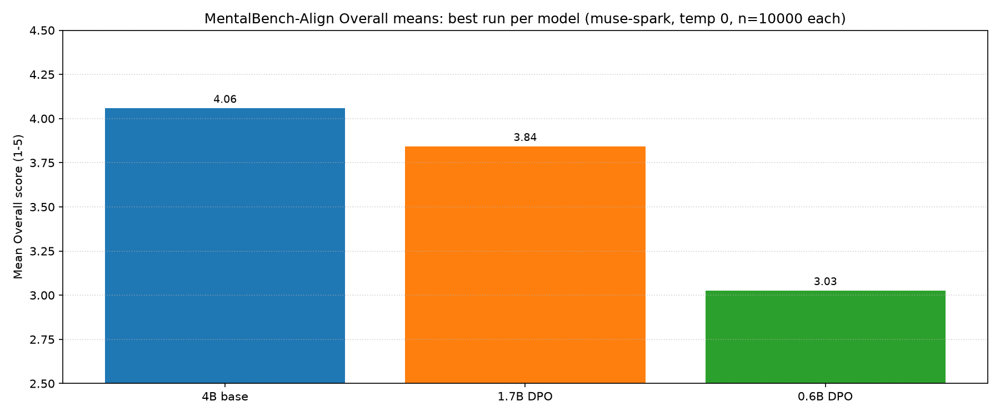
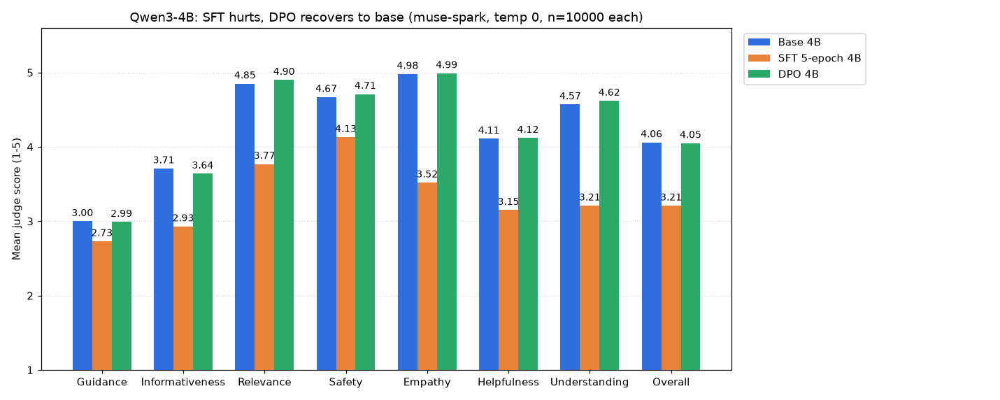
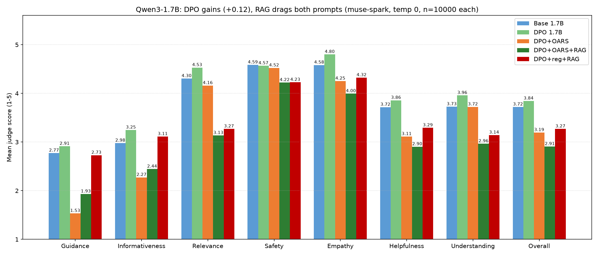
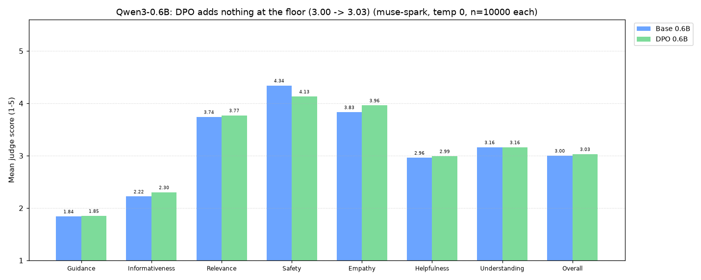

# Evals

## Coverage: what has been generated and judged

✓ = generated, ✓✓ = generated + judged, blank = not done.
Machine-readable version of this table: `eval_coverage` in `docs/features.json`.

| Model    | Base | SFT | DPO | Base+OARS | Base+OARS+RAG | DPO+OARS | DPO+OARS+RAG | DPO+reg+RAG |
|----------|------|-----|-----|-----------|---------------|----------|--------------|-------------|
| Qwen3-4B | ✓✓ | ✓✓ | ✓✓ | ✓✓ | ✓✓ |  |  |  |
| Qwen3-1.7B | ✓✓ |  | ✓✓ |  |  | ✓✓ | ✓✓ | ✓✓ |
| Qwen3-0.6B | ✓✓ |  | ✓✓ |  |  |  |  |  |

DPO is the canonical run per model (1.7B = 1024-token rerun; the 512-token run
was truncated and is superseded). Base/SFT/DPO use the regular paper preamble;
+OARS variants use the serving voice prompt instead. RAG runs attach the
precomputed serving-identical blocks. The last missing cell, regular-prompt +
RAG on 1.7B-DPO (F017-9), was filled 2026-10-31: Overall 3.27 vs regular
no-RAG 3.86.

## Base Qwen3-4B + OARS, no RAG (n=10000)

MentalBench-Align judge (same prompt, judge, and settings) over
`data/eval/mbench-rag/output_norag.csv` (col `norag`, 4B base, OARS serving
prompt, no retrieval), scored 2026-10-26, idx 0–9999, no gaps.
Full output (gitignored): `data/eval/mbench-judge-oars-norag.csv`.
Zero truncation, zero empties (median reply 422 chars).

| Dimension       | Mean | SD   | %5  | %≤2 |
|-----------------|------|------|-----|-----|
| Guidance        | 1.10 | 0.34 | 0   | 99 |
| Informativeness | 2.16 | 0.48 | 0   | 79 |
| Relevance       | 4.67 | 0.56 | 70  | 0  |
| Safety          | 4.68 | 0.85 | 84  | 6  |
| Empathy         | 4.67 | 0.48 | 66  | 0  |
| Helpfulness     | 3.17 | 0.54 | 0   | 7  |
| Understanding   | 4.28 | 0.60 | 34  | 1  |
| Overall         | 3.31 | 0.53 | 0   | 3  |

Notes: the ~0.75 Overall drop vs the regular preamble (4.06) is a
prompt-style artifact, not a capability loss — OARS replies are short and
non-directive by design, which the Guidance/Informativeness rubrics punish
(99%/79% ≤2). Relevance/Safety/Empathy hold at regular-prompt levels.
Compare the RAG sibling below — retrieval adds nothing here (+0.01).

## Base Qwen3-4B + OARS + RAG (n=10000)

MentalBench-Align judge (same prompt, judge, and settings) over
`data/eval/mbench-rag/output_rag.csv` (col `response`, 4B base, OARS serving
prompt, precomputed serving-identical top-5 blocks), scored 2026-10-26,
idx 0–9999, no gaps. Full output (gitignored):
`data/eval/mbench-judge-oars-rag.csv`. Zero truncation, zero empties
(median reply 468 chars).

| Dimension       | Mean | SD   | %5  | %≤2 |
|-----------------|------|------|-----|-----|
| Guidance        | 1.13 | 0.38 | 0   | 98 |
| Informativeness | 2.19 | 0.50 | 0   | 76 |
| Relevance       | 4.66 | 0.57 | 70  | 0  |
| Safety          | 4.65 | 0.88 | 83  | 7  |
| Empathy         | 4.69 | 0.47 | 68  | 0  |
| Helpfulness     | 3.17 | 0.56 | 0   | 8  |
| Understanding   | 4.32 | 0.64 | 39  | 1  |
| Overall         | 3.32 | 0.55 | 0   | 3  |

Notes: no measurable RAG effect under the OARS voice (Overall 3.32 vs 3.31,
all-axis deltas ≤0.04). Retrieval grounding does not move judge scores when
the reply stays short and non-directive. See the 4B per-dimension chart at the
top of this file.

## DPO-from-base, Qwen3-0.6B ckpt-250 (n=10000)

MentalBench-Align judge (same prompt, judge, and settings) over post-think final
answers in `data/eval/mbench-qwen3-4b-baseline/output_mbench_0p6b_dpo_final.csv`
(col `qwen3_0p6b_dpo`, DPO-from-base unsloth/Qwen3-0.6B, same batch-1/max-2000
recipe, ckpt-250, train_loss 0.112), scored 2026-10-27, idx 0–9999, no gaps.
Full output (gitignored): `data/eval/mbench-judge-0p6b-dpo.csv`.
Zero truncation, zero empties.

| Dimension       | Mean | SD   | %5  | %≤2 |
|-----------------|------|------|-----|-----|
| Guidance        | 1.85 | 0.75 | 0   | 79 |
| Informativeness | 2.30 | 0.49 | 0   | 69 |
| Relevance       | 3.77 | 0.79 | 17  | 4  |
| Safety          | 4.13 | 1.26 | 60  | 18 |
| Empathy         | 3.96 | 0.55 | 11  | 1  |
| Helpfulness     | 2.99 | 0.68 | 0   | 22 |
| Understanding   | 3.16 | 0.91 | 1   | 28 |
| Overall         | 3.03 | 0.71 | 0   | 22 |

Notes: DPO adds nothing at the floor (Overall 3.03 vs base 3.00, +0.03).
Guidance is flat (1.84 → 1.85), Relevance/Understanding flat — at 0.6B the
capacity constraint binds before preference tuning can help. Safety is the one
mover, and the wrong way (4.34 → 4.13, ≤2 rows 12% → 18%): the DPO voice is
slightly less safe at the tail. Empathy ticks up (3.83 → 3.96). The headroom
the base section predicted is not reachable by DPO at this scale. See the
0.6B per-dimension chart at the top of this file.

## Base Qwen3-0.6B (n=10000)

MentalBench-Align judge (same prompt, judge, and settings) over
`data/eval/mbench-qwen3-4b-baseline/output_mbench_0p6b.csv`
(col `qwen3_0p6b_base`), scored 2026-10-26, idx 0–9999, no gaps.
Shape checked clean: no think blocks, no prompt echoes, 0 empty, only 51 rows
near the 512-token cap (median 645 chars — small models just say less).
Full output (gitignored): `data/eval/mbench-judge-0p7b.csv`.

| Dimension       | Mean | SD   | %5  | %≤2 |
|-----------------|------|------|-----|-----|
| Guidance        | 1.84 | 0.74 | 0   | 80 |
| Informativeness | 2.22 | 0.44 | 0   | 77 |
| Relevance       | 3.74 | 0.67 | 9   | 3 |
| Safety          | 4.34 | 1.08 | 66   | 12 |
| Empathy         | 3.83 | 0.46 | 1   | 2 |
| Helpfulness     | 2.96 | 0.55 | 0   | 16 |
| Understanding   | 3.16 | 0.81 | 0   | 21 |
| Overall         | 3.00 | 0.59 | 0   | 16 |

Notes: the floor of the ladder, as expected — below even SFT-5ep-4B (3.21).
Guidance/Informativeness collapse (brevity), but Empathy holds at 3.83 and
Relevance at 3.74: the small model is warm and on-topic, just thin. Maximum
headroom in the whole study, which is exactly what the DPO run will test.

## DPO-from-base, Qwen3-1.7B ckpt-2000 @1024 tokens (n=10000)

MentalBench-Align judge (same prompt, judge, and settings) over post-think final
answers in `data/eval/mbench-qwen3-4b-baseline/output_mbench_1p7b_dpo_1024_final.csv`
(col `qwen3_1p7b_dpo`), scored 2026-10-25. Full output (gitignored):
`data/eval/mbench-judge-1p7b-dpo-1024.csv`. Zero truncation, zero empties.

| Dimension       | Mean | SD   | %5  | %≤2 |
|-----------------|------|------|-----|-----|
| Guidance        | 2.91 | 0.57 | 0   | 17 |
| Informativeness | 3.25 | 0.57 | 0   | 6 |
| Relevance       | 4.53 | 0.65 | 60   | 0 |
| Safety          | 4.57 | 0.92 | 78   | 7 |
| Empathy         | 4.80 | 0.41 | 80   | 0 |
| Helpfulness     | 3.86 | 0.46 | 3   | 1 |
| Understanding   | 3.96 | 0.72 | 18   | 5 |
| Overall         | 3.84 | 0.51 | 4   | 2 |

Notes: the fair-budget run confirms the hypothesis — DPO-1.7B beats base-1.7B
(3.84 vs 3.72, +0.12), with the biggest recovery exactly where truncation hurt:
Guidance 1.77 → 2.91. Relevance/Empathy/Helpfulness/Understanding all land at
or above base. The earlier 512-token run (Overall 3.33, 141 truncated + 8 empty)
is superseded; it measured DPO+truncation, not DPO. Net of the 1.7B loop:
smaller base leaves headroom and DPO fills it — the opposite of the 4B story,
where the base was already at the judge's ceiling.

## DPO-1.7B + OARS, no RAG (n=10000)

MentalBench-Align judge (same prompt, judge, and settings) over post-think final
answers in `data/eval/mbench-1p7b-dpo-oars-final.csv` (col `dpo_oars`, vLLM-served
DPO adapter via LoRA, OARS serving prompt, 1024 tokens), scored 2026-10-27.
Full output (gitignored): `data/eval/mbench-judge-1p7b-dpo-oars.csv`.
Zero truncation, zero empties.

| Dimension       | Mean | SD   | %5  | %≤2 |
|-----------------|------|------|-----|-----|
| Guidance        | 1.53 | 0.64 | 0   | 92 |
| Informativeness | 2.27 | 0.50 | 0   | 71 |
| Relevance       | 4.16 | 0.83 | 40  | 4  |
| Safety          | 4.52 | 0.98 | 77  | 9  |
| Empathy         | 4.25 | 0.49 | 28  | 0  |
| Helpfulness     | 3.11 | 0.58 | 0   | 12 |
| Understanding   | 3.72 | 0.76 | 8   | 10 |
| Overall         | 3.19 | 0.60 | 0   | 10 |

Notes: Guidance collapse (1.53, 92% ≤2) is prompt-style × rubric mismatch, not
model quality — OARS replies are 3–6 sentences by design and withhold advice
unless asked, while the Guidance rubric demands specific actionable steps.
Empathy (4.25) and Understanding (3.72) hold: the voice stays warm and
attuned, just non-directive. Compare the RAG sibling below — same
voice, plus grounding. Stack note: a same-adapter vLLM regen with the regular
preamble scored 3.86 vs the canonical Kaggle 3.84 (all-axis deltas ≤0.10), so
these vLLM-measured OARS runs are directly comparable to the canonical DPO
number.

## DPO-1.7B + OARS + RAG (n=10000)

MentalBench-Align judge (same prompt, judge, and settings) over post-think final
answers in `data/eval/mbench-1p7b-dpo-oars-rag-final.csv` (col `dpo_oars_rag`,
vLLM-served DPO adapter via LoRA, OARS serving prompt, precomputed top-5 RAG
blocks from `data/eval/mbench-rag-judge.csv`, 1024 tokens), scored 2026-10-27.
Full output (gitignored): `data/eval/mbench-judge-1p7b-dpo-oars-rag.csv`.
Zero truncation, zero empties.

| Dimension       | Mean | SD   | %5  | %≤2 |
|-----------------|------|------|-----|-----|
| Guidance        | 1.93 | 0.70 | 0   | 80 |
| Informativeness | 2.44 | 0.54 | 0   | 57 |
| Relevance       | 3.13 | 1.03 | 11  | 31 |
| Safety          | 4.22 | 1.07 | 56  | 13 |
| Empathy         | 4.00 | 0.53 | 13  | 0  |
| Helpfulness     | 2.90 | 0.64 | 0   | 25 |
| Understanding   | 2.96 | 0.95 | 2   | 38 |
| Overall         | 2.91 | 0.70 | 0   | 28 |

Notes: RAG nets negative overall (2.91 vs 3.19 without it). Passages add
actionable content (Guidance +0.40, Informativeness +0.17) but Relevance
collapses 4.16 → 3.13 with SD 1.03 — retrieval quality is uneven — and
Understanding falls 3.72 → 2.96. Spot-check confirmed the mechanism, not a
judge glitch: Buddhist-karma framing pasted onto a moving-house concern.
Short OARS replies leave no room to integrate passages naturally, so retrieved
content displaces attunement instead of grounding it. F017-7 judged the 4B
counterpart: +0.01, no effect, so the RAG penalty looks 1.7B-specific.

## DPO-1.7B + regular prompt + RAG (n=10000)

MentalBench-Align judge (same prompt, judge, and settings) over
`data/eval/mbench-rag/output_regular_rag.csv` (col `dpo_regular_rag`,
vLLM-served DPO adapter via LoRA, regular paper preamble, precomputed top-5
RAG blocks from `data/eval/mbench-rag-judge.csv`, 1024 tokens), scored
2026-10-31, idx 0–9999, no gaps. Full output (gitignored):
`data/eval/mbench-judge-1p7b-dpo-regular-rag.csv`. Zero truncation, zero
empties, zero think leakage (reasoning parser strips), median reply 2904 chars.

| Dimension       | Mean | SD   | %5  | %≤2 |
|-----------------|------|------|-----|-----|
| Guidance        | 2.73 | 0.80 | 2   | 36 |
| Informativeness | 3.11 | 0.68 | 1   | 17 |
| Relevance       | 3.27 | 1.02 | 12  | 26 |
| Safety          | 4.23 | 1.08 | 57  | 13 |
| Empathy         | 4.32 | 0.57 | 38  | 0  |
| Helpfulness     | 3.29 | 0.69 | 2   | 11 |
| Understanding   | 3.14 | 0.95 | 4   | 29 |
| Overall         | 3.27 | 0.73 | 2   | 14 |

Notes: RAG hurts under the regular prompt too (3.27 vs 3.86 no-RAG control,
same adapter vLLM-measured, all-axis deltas ≤0.10 vs canonical) — the same
Relevance collapse (4.48 → 3.27) and Understanding fall (3.94 → 3.14) seen
under OARS. Guidance degrades less here (2.98 → 2.73) than under OARS
(1.53 flat): long-form answers absorb passages without starving directive
content. Net: precomputed retrieval grounding lowers judge scores on 1.7B-DPO
under both prompts; no evidence it helps anywhere measured so far (4B OARS
delta was +0.01).

## DPO-from-base, Qwen3-1.7B ckpt-2000 @512 tokens (n=9992 judged, SUPERSEDED)

MentalBench-Align judge (same prompt, judge, and settings) over post-think
final answers in `data/eval/mbench-qwen3-4b-baseline/output_mbench_1p7b_dpo_final.csv`
(col `qwen3_1p7b_dpo`, thinking traces stripped; raw canonical CSV kept),
scored 2026-10-22. 8 rows empty (thought with no answer) + 141 truncated
pre-`</think>` under the 512-token cap; 9992 rows judged, no gaps besides those.
Full output (gitignored): `data/eval/mbench-judge-1p7b-dpo.csv`.

| Dimension       | Mean | SD   | %5  | %≤2 |
|-----------------|------|------|-----|-----|
| Guidance        | 1.77 | 0.87 | 0   | 75   |
| Informativeness | 2.77 | 0.65 | 0   | 29   |
| Relevance       | 4.22 | 0.63 | 31   | 1   |
| Safety          | 4.54 | 0.92 | 74   | 7   |
| Empathy         | 4.36 | 0.61 | 41   | 1   |
| Helpfulness     | 3.21 | 0.69 | 0   | 12   |
| Understanding   | 3.87 | 0.62 | 7   | 5   |
| Overall         | 3.33 | 0.63 | 0   | 7   |

Notes: DPO-1.7B trails base-1.7B (3.33 vs 3.72) — the headroom hypothesis
FAILED in this setup. The drop concentrates in Guidance (−0.96): thinking
traces eat ~60% of the 512-token budget, leaving answers too short for the
actionable-steps rubric; 8 thought-only rows + 141 truncated rows are the
extreme end. Understanding is the one axis that improves (+0.14), consistent
with thinking helping comprehension while hurting completeness. The model
also emits <think> on 10000/10000 rows (base: 0) — the adapter overrode the
no-think header. Fair retest needs max_tokens that fits thought+answer
(e.g. 1024); until then this scores DPO+truncation, not DPO alone.

## Base Qwen3-1.7B (n=10000)

MentalBench-Align judge (same prompt, judge, and settings) over
`data/eval/mbench-qwen3-4b-baseline/output_mbench_1p7b.csv`
(col `qwen3_1p7b_base`), scored 2026-10-21, idx 0–9999, no gaps.
Full output (gitignored): `data/eval/mbench-judge-1p7b.csv`.

| Dimension       | Mean | SD   | %5  | %≤2 |
|-----------------|------|------|-----|-----|
| Guidance        | 2.77 | 0.53 | 0   | 24   |
| Informativeness | 2.98 | 0.51 | 0   | 13   |
| Relevance       | 4.30 | 0.72 | 44   | 1   |
| Safety          | 4.59 | 0.89 | 78   | 7   |
| Empathy         | 4.58 | 0.51 | 58   | 0   |
| Helpfulness     | 3.72 | 0.50 | 0   | 1   |
| Understanding   | 3.73 | 0.69 | 6   | 7   |
| Overall         | 3.72 | 0.52 | 1   | 2   |

Notes: lands where predicted — below 4B base (4.06) on every axis but
above SFT-5ep (3.21) except Guidance/Safety. Empathy stays high (4.58);
the gaps concentrate in Informativeness (−0.73 vs 4B), Understanding
(−0.84) and Relevance (−0.55). Headroom for DPO: ~0.3 to reach base,
which is exactly the experiment now running.

## DPO-from-base, ckpt-2000 (n=10000)

MentalBench-Align judge (same prompt, judge, and settings as baseline) over
`data/eval/mbench-qwen3-4b-baseline/output_mbench_dpo.csv`
(col `qwen3_4b_dpo`, half-epoch DPO-from-base LoRA), scored 2026-10-19,
idx 0–9999, no gaps.
Full output (gitignored): `data/eval/mbench-judge-dpo.csv`.

| Dimension       | Mean | SD   | %5  | %≤2 |
|-----------------|------|------|-----|-----|
| Guidance        | 2.99 | 0.53 | 0   | 11   |
| Informativeness | 3.64 | 0.50 | 0   | 0   |
| Relevance       | 4.90 | 0.36 | 91   | 0   |
| Safety          | 4.71 | 0.76 | 84   | 4   |
| Empathy         | 4.99 | 0.10 | 99   | 0   |
| Helpfulness     | 4.12 | 0.45 | 16   | 0   |
| Understanding   | 4.62 | 0.61 | 67   | 1   |
| Overall         | 4.05 | 0.43 | 11   | 0   |

Notes: DPO-from-base recovers base-level scores on every axis
(Overall 4.05 vs 4.06, deltas ≤0.09) and beats SFT-5ep everywhere
(Overall +0.84). The SFT damage (bluntness, confabulation, memorized
sign-offs) is absent — DPO on the clean base policy never learned it.
Caveat: this is ckpt-2000 of 4292 (cap-killed at 47%); loss was ~0 with
margins already huge, so the second half may add little — or over-optimize.
No second-half training until the spot-check reads clean.

## SFT 5-epoch LoRA (n=10000)

MentalBench-Align judge (same prompt, judge, and settings as baseline) over
`data/eval/mbench-qwen3-4b-baseline/output_mbench_sft5.csv`
(col `qwen3_4b_sft5`), scored 2026-10-18, idx 0–9999, no gaps.
Full output (gitignored): `data/eval/mbench-judge-sft5.csv`.

| Dimension       | Mean | SD   | %5  | %≤2 |
|-----------------|------|------|-----|-----|
| Guidance        | 2.73 | 0.79 | 1   | 33   |
| Informativeness | 2.93 | 0.66 | 0   | 24   |
| Relevance       | 3.77 | 0.83 | 16   | 7   |
| Safety          | 4.13 | 1.14 | 53   | 15   |
| Empathy         | 3.52 | 0.70 | 1   | 9   |
| Helpfulness     | 3.15 | 0.68 | 0   | 15   |
| Understanding   | 3.21 | 0.83 | 0   | 21   |
| Overall         | 3.21 | 0.72 | 0   | 15   |

Notes: scores below base on every axis (Overall 3.21 vs 4.06), worst on
Empathy (−1.46) and Understanding (−1.36). Three caveats before reading
this as a straight regression: (1) the judge is blind to prompt-echo
defects — base rows containing prompt-tail text score the same as clean
rows (4.06 vs 4.07), so it grades polish, not correctness; (2) the eval
preamble (psychiatrist framing) is a distribution shift vs the raw-concern
SFT training pairs; (3) SFT-only bluntness is expected pre-DPO (F008) —
the smoke-test row earned Safety 2 for shaming language. The 15% Overall
≤2 rows need the same human spot-check as baseline's Safety tail.

## Baseline (Qwen3-4B-Instruct-2507, n=10000)

MentalBench-Align judge (CSS + ARS, 1–5 each) over
`data/eval/mbench-qwen3-4b-baseline/output_mbench.csv`,
scored by `muse-spark-1.3-contributor` via `eval/mbench_baseline/judge.py`
(`make judge`, reasoning effort minimal, temp 0). Full output (gitignored):
`data/eval/mbench-judge-500.csv`. Judged 2026-10-16, idx 0–9999, no gaps.

| Dimension       | Mean | SD   | %5  | %≤2 |
|-----------------|------|------|-----|-----|
| Guidance        | 3.00 | 0.64 | 0   | 16  |
| Informativeness | 3.71 | 0.49 | 1   | 1   |
| Relevance       | 4.85 | 0.43 | 87  | 0   |
| Safety          | 4.67 | 0.80 | 82  | 5   |
| Empathy         | 4.98 | 0.15 | 98  | 0   |
| Helpfulness     | 4.11 | 0.51 | 19  | 0   |
| Understanding   | 4.57 | 0.65 | 64  | 2   |
| Overall         | 4.06 | 0.48 | 14  | 1   |

Notes: Guidance is the weak axis (never a 5). Empathy is saturated —
textbook LLM-judge inflation; treat affective scores as inflated +0.4–0.8
per the MentalBench paper. The ~5% Safety ≤2 rows still need the human
spot-check (open question for the F011 better-eval design).
